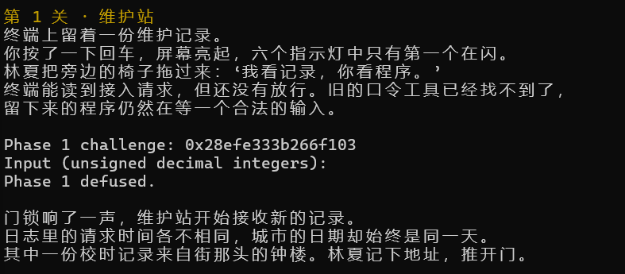
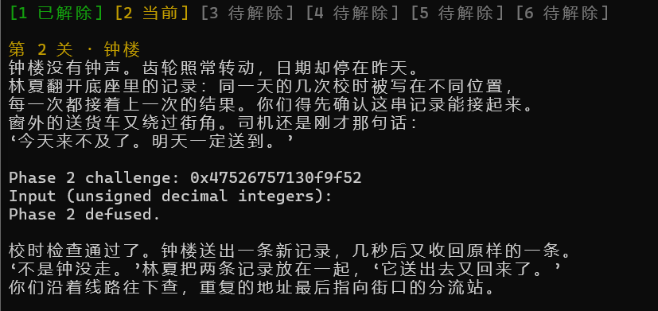
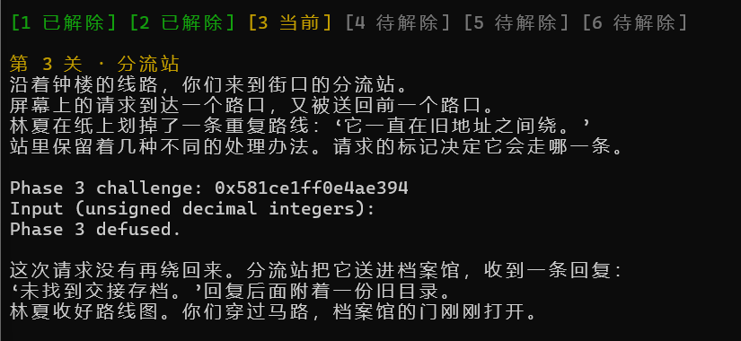
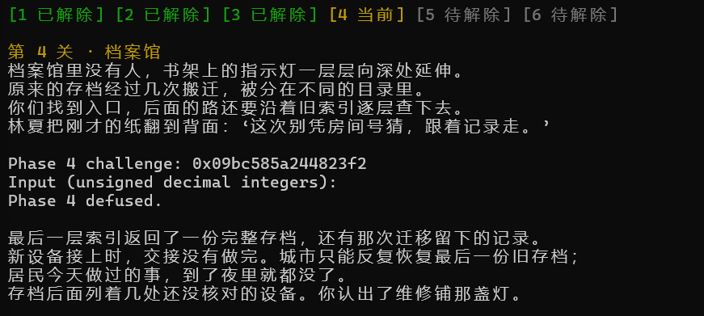
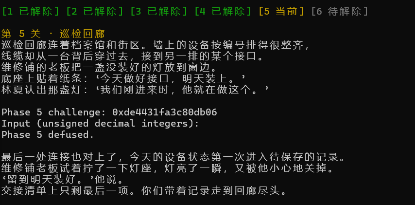
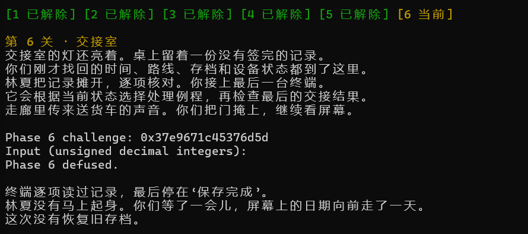
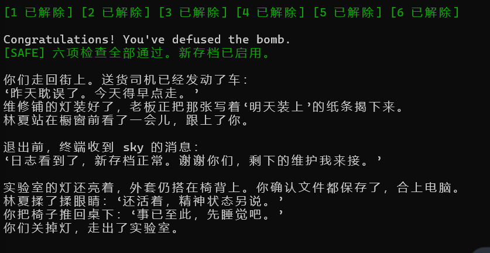

# Lab2 BombLab 实验报告

## 0. 概览

| 项目 | 结果 |
|---|---|
| 环境 | WSL2 Ubuntu 24.04，Linux x86_64，GCC 13，GDB 17.1，binutils 2.42 |
| 正式六关 | 公开测试 **60/60** |
| Honor | 公开测试 **10/10**，输出 `Secret phase defused.` |
| 额外验证 | 连续 61 个 seed + 24 个随机 64 位 seed 全部通过；每关边界 challenge 全部通过 |

本实验的炸弹是参数化的：每关给出一个 64 位 `challenge`，程序用它在内部算出期望口令，再与输入比较。因此提交的 `defuser.c` 实现的是**从 challenge 到口令的计算函数**，而不是某一组固定答案。

分析流程固定为三步：

1. `objdump -d --no-show-raw-insn --disassemble=<函数>` 导出目标函数汇编，`nm` 列出全部符号（炸弹未 strip，helper 名字可见）；
2. 从汇编读出计算关系，写成 C 表达式；
3. 用 GDB 在关键 `cmp` 处停住，核对"程序算出的值"与"我的表达式算出的值"，再用真实炸弹验证多个 seed。

最终 `defuser.c` 只使用整数运算和 `snprintf`，没有文件、网络、进程或内联汇编调用。

## 1. 第 1 关：函数调用与返回值

`phase_01` 先用 `valid_u32_fields(s, 1)` 限定**恰好 1 个整数**，`sscanf` 的格式串也确认是 `"%u"`：

```
40209d: mov    $0x1,%esi          ; 字段数 = 1
4020aa: call   valid_u32_fields
4020ce: call   __isoc99_sscanf    ; "%u"
4020d8: mov    %r12,%rdi          ; rdi = challenge
4020db: call   p1_compute
4020e0: cmp    %eax,-0x14(%rbp)   ; 输入 == p1_compute(challenge)
4020e3: sete   %al
```

`p1_compute` 把 challenge 拆成三段，交给三个小函数依次混合：

```
40205d: shr    $0x20,%rax         ; hi = challenge >> 32
402064: shr    $0x10,%rdx         ; mid = challenge >> 16
40206d: call   p1_step2           ; (rdi=hi, rsi=lo)
40207a: call   p1_step0           ; (rdi=lo, rsi=mid)
402083: call   p1_step1
```

三个 helper 各只有两三条指令，直接翻译即可：

- `p1_step2`：`lea (%rdi,%rsi,2),%eax` → `a + 2b`，再 `xor $0x3b51`
- `p1_step0`：`xor $0x9aeb,%esi` 后 `lea (%rsi,%rdi,4),%eax` → `(b ^ 0x9aeb) + 4a`
- `p1_step1`：`lea (%rdi,%rdi,2),%eax` → `3a`，`add $0x38f6,%esi`，再 `xor` 二者

恢复出的关系（全部按 32 位回绕）：

```
lo  = challenge & 0xffffffff        hi = challenge >> 32      mid = (challenge >> 16) & 0xffffffff
t2  = (hi + 2*lo)        ^ 0x3b51
t0  = ((mid ^ 0x9aeb) + 4*lo)
ans = (3*t0)             ^ (t2 + 0x38f6)
```

口令为 1 个整数：`ans`。

**推理要点**：`movzbl %al` 类指令出现时要取 `& 0xff`；`lea` 承担了乘加，`lea (%rsi,%rdi,4)` 就是 `rsi + 4*rdi`，不要误读成立即数偏移。

## 2. 第 2 关：数组与递推

格式串为 `"%u %u %u %u %u %u"`，`valid_u32_fields(s, 6)`，共 **6** 个整数，存放在 `rbp-0x40` 起的连续 6 个 int。

第一个元素先与 challenge 派生值比较：

```
40215a: mov    %r13,%rax
402160: shr    $0x1c,%rax          ; challenge >> 28
402164: add    %eax,%eax           ; *2
402166: movzbl %al,%eax            ; & 0xff
402169: add    $0x14,%eax          ; + 20
40216c: cmp    %eax,%esi           ; a[0]
```

随后是一个 5 次的循环，`cl = 3,5,7,9,11`，`edi = 12,24,...,60`：

```
40217e: mov    %r13,%rax
402181: shr    %cl,%rax            ; challenge >> (3+2i)
402184: and    $0x3f,%eax          ; 取低 6 位
402187: add    %esi,%eax           ; + a[i]
402189: mov    0x4(%rdx),%esi      ; 载入 a[i+1]
40218c: xor    %edi,%eax           ; ^ 12*(i+1)
40218e: cmp    %eax,%esi
```

恢复出：

```
a[0]   = (uint8_t)(2 * (uint32_t)(challenge >> 28)) + 20
a[i+1] = (((challenge >> (3 + 2*i)) & 0x3f) + a[i]) ^ (12 * (i + 1))    i = 0..4
```

**推理要点**：比较在循环末尾且期望值依赖上一轮 → 这是递推，输入是被验证的序列，直接正向生成即可。`add %eax,%eax` 后面紧跟 `movzbl %al`，说明中间结果只保留低 8 位，不能把 `2*(challenge>>28)` 直接与 20 相加后取任意宽度。

## 3. 第 3 关：switch 与跳转表

2 个整数，`"%u %u"`。第二个数由 `p3_dispatch` 决定：

```
4022fc: mov    %r12d,%edi
402301: and    $0x7,%edi           ; sel = challenge & 7
402304: cmp    %edi,-0x18(%rbp)    ; 输入 1 == sel
402309: mov    %r12,%rax
40230f: shr    $0x3,%rax
402313: shr    $0x20,%rsi
402317: xor    %eax,%esi           ; x = (challenge>>32) ^ (challenge>>3)
402319: call   p3_dispatch
40231e: cmp    %eax,-0x14(%rbp)    ; 输入 2 == case 结果
```

`p3_dispatch` 用 `jmp *0x405820(,%rax,8)` 查表。用 `x/8a 0x405820` 读出 8 个条目，再顺着跳转桩定位到具体 case，得到映射：

| sel | 0 | 1 | 2 | 3 | 4 | 5 | 6 | 7 |
|---|---|---|---|---|---|---|---|---|
| case | 6 | 5 | 1 | 2 | 3 | 7 | 4 | 0 |

各 case 的计算（`x` 即上面的 `esi`）：

| sel | 表达式 |
|---|---|
| 0 | `5x + 0x5560` |
| 1 | `(x ^ 0xfe35) + (x >> 2)` |
| 2 | `(2x) ^ 0x906d` |
| 3 | `5x + 0x4d6b` |
| 4 | `5x + 0x28b2c` |
| 5 | `5x + 0x27303` |
| 6 | `(2x) ^ 0xab88` |
| 7 | `(x ^ 0xf2a0) + (x >> 2)` |

口令为 2 个整数：`sel` 与 `case[sel](x)`。

**推理要点**：`5x` 由 `lea 0x4d6b(%rdi,%rdi,4)` 实现（`rdi + 4*rdi + 常量`），不是"先乘 4 再加 0x4d6b"。跳转表必须按内存里的实际顺序读，不能按源码书写顺序猜。

## 4. 第 4 关：递归与二分

1 个整数。入口准备四个参数：

```
4023e8: mov    %r12,%rcx          ; c
4023f1: xor    %esi,%esi          ; lo = 0
4023f7: shr    $0x7,%rcx          ; challenge >> 7
4023fb: and    $0x7f,%edi         ; x = challenge & 0x7f
4023fe: mov    $0x7f,%edx         ; hi = 127
402403: xor    %eax,%ecx          ; c = (challenge>>32) ^ (challenge>>7)
402405: call   p4_walk
```

`p4_walk(x, lo, hi, c)` 在 `[lo, hi]` 上二分：

```
402338: sub    %esi,%edi          ; hi - lo
40233a: shr    $1,%edi            ; /2
40233c: add    %esi,%edi          ; mid
40233e: cmp    %eax,%edi
402340: je     402390             ; x == mid -> 基本情况
402347: lea    (%rdi,%rcx,1),%ebx ; ebx = mid + c
```

基本情况 `402390: lea 0x98(%rdi),%eax; xor %ecx,%eax` → `(x + 0x98) ^ c`。
递归返回后在 `40235c`/`40237a` 处 `lea (%rax,%rax,4),%eax`（`5*ret`），再 `xor %ebx`，最后分别 `xor $0x1c`（x > mid）或 `xor $0x2`（x < mid）。

因此口令就是这个函数的值：

```c
static uint32_t p4_walk(uint32_t x, uint32_t lo, uint32_t hi, uint32_t c) {
    uint32_t mid = lo + ((hi - lo) >> 1);
    if (mid == x) return (x + 0x98) ^ c;
    if (x < mid)  return (p4_walk(x, lo, mid - 1, c) * 5u) ^ (mid + c) ^ 2u;
    return (p4_walk(x, mid + 1, hi, c) * 5u) ^ (mid + c) ^ 0x1cu;
}
```

**推理要点**：`x = challenge & 0x7f` 落在 `[0,127]`，与初始区间完全一致，所以递归一定命中基本情况，不会出现 `lo > hi`。比较用 `jb`（无符号），照抄无符号语义即可；折叠时的 `^` 顺序不影响结果（异或可交换），但 `5*ret` 的 32 位回绕必须保留。

## 5. 第 5 关：结构体布局与链表

2 个整数。`p5_traverse(challenge, &out)` 返回值与第一个输入比较，`out` 与第二个输入比较：

```
4024cc: lea    -0x14(%rbp),%rsi
4024d3: call   p5_traverse
4024dc: cmp    %edx,-0x1c(%rbp)   ; 输入 1 == 返回值
4024e4: cmp    %eax,-0x18(%rbp)   ; 输入 2 == out
```

遍历起点由 `p5_heads[challenge & 7]` 决定，节点结构为 `{int a; int b; node *next;}`（16 字节）：

```
40242d: and    $0x7,%eax
402434: mov    0x405b60(,%rax,8),%rdx   ; 起点节点
402449: mov    0x4(%rdx),%esi           ; b
40244e: xor    $0xc075,%eax
402453: lea    (%rax,%rax,2),%eax       ; *3
402456: add    (%rdx),%eax              ; + a
40245b: xor    %esi,%eax                ; ^ b
40245d: and    $0x3,%edi                ; 步数 = (challenge>>3) & 3
```

循环体内 `0x8(%rdx)` 取 `next`，每步 `v = (v*3 + a) ^ b`，并把当前 `b` 写入 `out`。

用 GDB 遍历 `0x405b60` 的 8 个 head，得到 12 个节点的 `{a, b, next}`：

| 起点下标 | 0 | 1 | 2 | 3 | 4 | 5 | 6 | 7 |
|---|---|---|---|---|---|---|---|---|
| 节点 | 6 | 1 | 11 | 10 | 9 | 0 | 4 | 7 |

全部 head 最终汇入同一条尾链 `6→1→11→10→9→0→4→7→2→8→5→3→NULL`。恢复出：

```
start = head[challenge & 7];  steps = (challenge >> 3) & 3
v = ((((challenge >> 6) ^ (challenge >> 32)) ^ 0xc075) * 3 + a_start) ^ b_start
重复 steps 次： v = (v * 3 + a) ^ b
口令 = (v, 最后一个节点的 b)
```

**推理要点**：结构体里 `a` 在偏移 0、`b` 在偏移 4、`next` 在偏移 8，必须从 `0x4(%rdx)`、`0x8(%rdx)` 读出，不能按"看起来像两个 int"猜。`steps` 最大为 3，最多访问 4 个节点，尾链长度足够，不需要处理空指针。

## 6. 第 6 关：函数指针表与间接调用

1 个整数。`p6_dispatch` 连续两次间接调用同一张表：

```
4025a0: and    $0x38,%ebx        ; 第二次调用的字节偏移
4025a3: and    $0x7,%eax         ; 第一次调用下标 = challenge & 7
4025a6: call   *0x405e00(,%rax,8)
4025ad: xor    $0x1166,%eax
4025b4: call   *0x405e00(%rbx)   ; 下标 = (challenge>>3) & 7
4025bf: add    $0x4f7,%eax
```

参数在 `40258c`–`402597` 准备：`x = (challenge >> 6) ^ (challenge >> 32)`。

表内容（`x/8a 0x405e00`）：`{op1, op3, op2, op3, op5, op0, op4, op3}`。六个 op 都很短：

| op | 表达式 |
|---|---|
| 0 | `rol2(x) ^ 0x4ceb` |
| 1 | `(x ^ 0xbb26) + (x << 7)` |
| 2 | `((x >> 5) ^ x) + 0x657c` |
| 3 | `ror2(x)` |
| 4 | `((x << 7) + 0x1ea8) ^ (7x)` |
| 5 | `(x + 0x6ae) ^ (x >> 5)` |

于是口令为 1 个整数：

```
t   = op[challenge & 7](x) ^ 0x1166
ans = op[(challenge >> 3) & 7](t) + 0x4f7
```

**推理要点**：`op4` 里 `lea 0x0(,%rdi,8),%edx` 后 `sub %edi,%edx` 得到 `7x`，不是 `8x`。间接调用前后 `rdi` 的含义变了，必须按每次 `call` 重新判断参数。

## 7. Honor

`solve_secret(challenge, context, out, cap)` 写出完整的第七行。入口 `secret_gate` 的检查分两段：

```
40276c: call   strlen
402771: sub    $0x24,%rax         ; len - 36
402775: cmp    $0x7f,%rax
402779: jbe    ...                ; 36 <= len <= 163
402796: call   secret_copy        ; 拷贝到 rbp-0xd0
40279b: cmpl   $0x4e45504f,-0xb0(%rbp)   ; 偏移 32 处必须是 "OPEN"
4027ad: lea    -0xac(%rbp),%rdi   ; 偏移 36 起的子串交给 secret_phase
```

`-0xb0` 相对 `rbp-0xd0` 正好是 **+32**，`-0xac` 是 **+36**。所以缓冲区布局是 `char prefix[32]; uint32_t magic; char numbers[]`，`magic` 必须等于 `0x4e45504f`，即小端下的 `"OPEN"`；后面跟 3 个整数（`valid_u32_fields(s, 3)` + `"%u %u %u"`）。

`secret_phase` 的三个期望值由 `challenge` 与 `context` 混合：

```
4026b0: mov    %r13d,%ecx
4026b5: and    $0x3,%ecx          ; pick = context & 3
4026b8: cmp    %ecx,-0x2c(%rbp)   ; v0 == pick
4026dc: mov    %esi,%edi          ; esi = cmix = (ch>>32) ^ ch
4026e1: xor    %r8d,%edi          ; x = cmix ^ tmix, tmix = (ctx>>32) ^ ctx
4026e4: call   secret_mix
4026e9: xor    %r9d,%eax          ; r9 = 0xf5ef*pick ^ (ctx>>16)
4026ec: cmp    %eax,-0x28(%rbp)   ; v1
4026f1: shr    $0x3,%esi
4026f4: lea    0xe036(%r8,%rcx,1),%edx
4026fc: add    %esi,%edx
4026fe: xor    %edx,%eax          ; eax 此时已是 v1
402700: cmp    -0x24(%rbp),%eax   ; v2
```

`secret_mix(x) = ((x >> 3) ^ 0xe036) + (x ^ 0xf5ef)`。注意 `4026e9` 的 `xor %r9d,%eax` 之后 `eax` 已是 `v1`，`4026fe` 是拿 **v1** 再异或，而不是重新从 `mix` 出发——这一点最初写错，用 GDB 在 `0x402700` 打出"程序算的 3422560075 vs 我算的 2004526757"才定位到。

最终构造：`32 个填充字符 + "OPEN" + "v0 v1 v2"`，总长 58，落在 36–163 内。

## 8. 验证记录

**公开测试**（`tests/public.json` 中的 10 个 seed × 六关）：

```
Public tests: 60/60
Secret public tests: 10/10
```

**非公开 seed 验证**（seed 424242 不在公开列表中）：

```
$ ./defuser --seed 424242 --phase 3 | ./bomb --seed 424242 --phase 3
Phase 3 defused.
$ ./defuser --seed 424242 --phase 5 | ./bomb --seed 424242 --phase 5
Phase 5 defused.
```

**边界 challenge**（`--challenge` 直接指定，绕开 seed）：

| challenge | 结果 |
|---|---|
| `0x0000000000000000` | 六关全部 defused |
| `0x0000000000000001` | 全部 defused |
| `0x00000000ffffffff` | 全部 defused |
| `0xffffffffffffffff` | 全部 defused |
| `0x8000000000000000` | 全部 defused |
| `0x1000000000000001` | 全部 defused |

**规模验证**：seed 300–360 连续 61 个、以及 24 个随机 64 位 seed，均"六关 + Honor"一次通过（脚本比较运行输出中是否出现 `Secret phase defused.`）。

这些测试针对的正是最容易出错的几处：32 位回绕（`0xffffffff`）、高位段参与运算（`0x8000...`）、移位边界（`0`、`1`）、以及 `(challenge >> 28) * 2` 被截到低 8 位的情形。

## 9. 运行结果

以下截图均为本人在终端实际运行 `./defuser --seed 42 | ./bomb --seed 42` 时逐关截取，未做任何修改。















公开测试与非公开 seed、边界 challenge 的验证记录（终端文本，可直接复现）：

```text
$ python3 public_test.py
Public tests: 60/60
Secret public tests: 10/10

$ ./defuser --seed 424242 --phase 3 | ./bomb --seed 424242 --phase 3
Phase 3 challenge: 0xa717c45a6f5d6fc3
Input (unsigned decimal integers):
Phase 3 defused.

$ ./defuser --phase 4 --challenge 18446744073709551615 | ./bomb --phase 4 --challenge 18446744073709551615
Phase 4 challenge: 0xffffffffffffffff
Input (unsigned decimal integers):
Phase 4 defused.
```

## 10. 工具使用说明

按课程公告允许的辅助范围，逐项说明本报告中的实际使用情况。

### 10.1 解释汇编指令、调用约定、C 语言语义与 GDB 的使用方法

阅读 `objdump` 输出时，用辅助工具解释过以下内容，并逐条回到反汇编中核对：

- **操作数顺序与语义**：AT&T 语法 `cmp %eax,-0x14(%rbp)` 是"内存减 eax"；`sub %esi,%edi` 是 `edi -= esi`；`lea (%rdi,%rdi,4),%eax` 是 `5x` 而不是带偏移的访存。
- **宽度与符号扩展**：`movzbl %al,%eax` 是 `& 0xff`（零扩展），`movsbl` 才是符号扩展；`shr` 为逻辑右移、`sar` 为算术右移；`imul` 只保留低 32 位。
- **编译器惯用法**：`lea (%rsi,%rdi,4)`、`add $eax,$eax` 这类乘加；`rep stos %rax` 的清零循环；`notrack jmp *0x405820(,%rax,8)` 是 8 字节表项的跳转表，`call *0x405e00(,%rax,8)` 是函数指针调用。
- **调用约定**：关卡入口 `rdi` 是输入串、`rsi` 是 challenge；到 `sscanf` 处 `rsi` 变成格式串、`rdx`/`rcx`/`r8`/`r9` 是输出指针，说明同一个寄存器在不同 `call` 处含义不同；helper 的返回值在 `eax`。
- **GDB 用法**：`break *phase_01` 停在第一条指令、`break phase_01` 会跳过序言；`x/8a` 按地址显示并解析符号；`x/40gx` 按 8 字节步长读结构体；`gdb -batch -x 脚本` 做批处理，便于把每次观察记录成文本。

在阅读过程中，也用它把指令片段翻译成 C 表达式草稿（例如 `p1_compute` 的三段数据流），这些草稿均逐条对照 `objdump` 输出，并以炸弹是否接受作为最终判据。

### 10.2 核对已有推理、定位编译或运行错误、设计验证方法

- **核对推理**：每关先从汇编写出计算关系，再到关键 `cmp` 处用 GDB 打印"程序算出的值"与"输入值"。例如第 1 关在 `0x4020e0` 处得到 `eax = 2345857685`，与输入一致，才确认 `p1_compute` 的三步混合关系。
- **定位运行错误**：Honor 的 `v2` 最初按 `mix ^ (...)` 计算，实测不符。在 `0x402700` 处打印程序算出的 3422560075 与自己算的 2004526757 对比，回到 `0x4026e9` 发现 `xor %r9d,%eax` 之后 `eax` 已经是 `v1`，改为 `v1 ^ (...)` 后通过——这是本实验唯一一次公式错误。
- **定位编译错误**：`-Werror -Wpedantic` 下未使用参数会直接编译失败，用 `(void)` 标注；`write_answer` 在截断时返回非零，会表现为 `solver_error`。
- **设计验证方法**：单 seed → 公开测试 10 个 seed → 换非公开 seed → `--challenge` 边界扫描 → 61 个连续 seed 与 24 个随机 64 位 seed 全流程复跑。这套顺序是逐层加码的，任何一层失败都能立刻定位到具体关卡。

### 10.3 结合已完成的分析讨论边界条件与测试结果

- 讨论后选定四个最能暴露宽度错误的 challenge：`0`、`1`、`0xffffffff`（32 位全 1）、`0xffffffffffffffff`（64 位全 1）；另补 `0x8000000000000000`（最高位单独置位）与 `0x1000000000000001`（高位段与低位段同时非零）。
- 第 2 关 `a[0]` 的 `movzbl %al` 决定了只保留低 8 位，因此边界测试必须覆盖 `2*(challenge>>28)` 超过 255 的情形；这一条正是从汇编里读出来的，不是遍历出来的。
- 第 5 关 `steps = (challenge>>3)&3` 最大为 3，节点链长度足够，因此不需要处理空指针；这类"边界不用测"的结论也是先读汇编再决定，而不是省略测试。
- 测试结果为：上述 challenge 在六关全部通过；seed 300–360 连续 61 个与 24 个随机 64 位 seed 全部输出 `Secret phase defused.`。

### 10.4 帮助整理报告

- 报告的结构、表格和排版由辅助工具生成草稿；**汇编片段、推理链、GDB 对照数据与运行截图均来自本人的实际调试过程**，公开测试、seed 扫描与边界扫描的结果均为本地真实运行的输出。
- 引用资料仅限课程实验页面、CS:APP 教材与 GDB 官方文档，没有引入未经核实的外部来源。
- 未编造分析过程或实验结果；第 1–7 节的每一条计算关系都能在对应汇编片段中找到依据，并可在 GDB 中复现。

## 11. 参考资料

- CS:APP 第 3 章《程序的机器级表示》
- CS:APP x86-64 GDB 速查表：<http://csapp.cs.cmu.edu/3e/docs/gdbnotes-x86-64.pdf>
- GDB 官方文档：<https://www.sourceware.org/gdb/documentation/>
- 课程实验页面：<https://ics-26fall-fdu.github.io/labs/lab2-bomb-lab/>
- 课程模板仓库中的 `tutor/` 与 `teaching/` 目录
